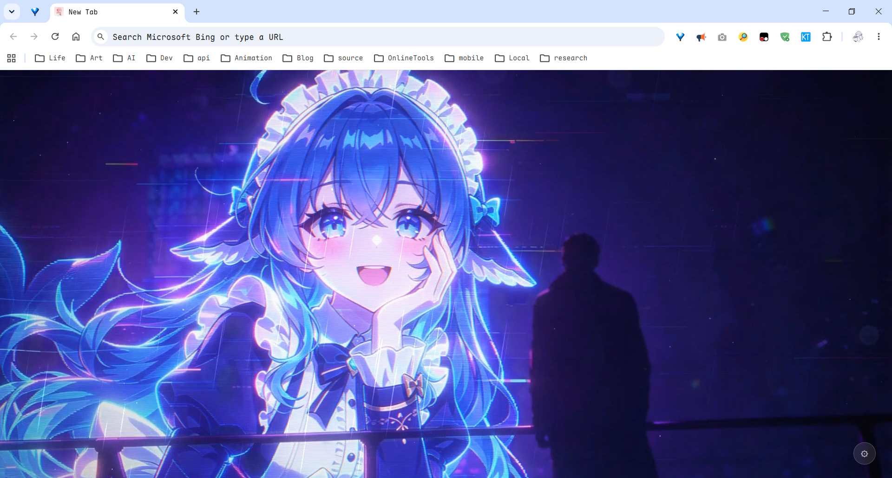
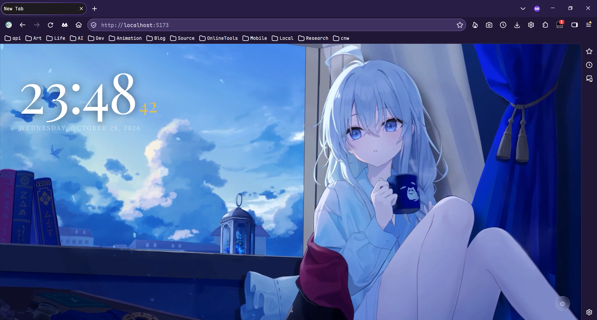

# PTab

> 以本地视频为背景的沉浸式新标签页扩展（支持 Chrome / Edge / Firefox）

**AI 开发文档**: [docs/.ai/index.md](docs/.ai/index.md)

>[!NOTE]
> 本项目90%以上代码由AI生成


每次打开新标签页，都是一段属于自己的安静时刻。

---

## 功能

- **全屏视频背景** — 通过设置面板上传本地视频，完全离线，无需联网
- **实时时钟** — 大字 HH:MM + 秒数高亮，每秒更新，可在设置中整体开关
- **个性化设置** — 上传视频、开关时钟与日期、九宫格自定义时钟位置、调整遮罩深度、自定义主题色
- **轻量无依赖** — 数据存 localStorage + IndexedDB，不联网，无追踪

---

## 预览





---

## 项目结构

```
PTab/
├── assets/                    # 仓库静态资源
├── public/
│   ├── manifest.json          # 扩展配置（MV3）
│   └── icon.png               # 扩展图标
├── src/
│   ├── components/
│   │   ├── VideoBackground.jsx  # 全屏视频 + 遮罩
│   │   ├── Clock.jsx            # 实时时钟
│   │   └── SettingsPanel.jsx    # 设置面板（含上传、时钟开关）
│   ├── utils/
│   │   └── db.js                # IndexedDB 存储
│   ├── App.jsx                  # 根组件 / 状态管理
│   ├── App.css                  # 全局样式
│   └── main.jsx                 # 入口文件
├── .github/workflows/release.yml # Release 自动构建发布
├── vite.config.js               # Vite 配置
└── index.html
```

---

## 快速开始

### 环境要求

- Node.js 18+
- Google Chrome 88+ / Microsoft Edge 88+ / Firefox 109+

### 1. 安装依赖

```bash
npm install
```

### 2. 本地预览

```bash
npm run dev
# 访问 http://localhost:5173
```

### 3. 构建扩展

```bash
# Chrome / Edge
npm run build:chrome
# 产物输出到 output/chrome/

# Firefox
npm run build:firefox
# 产物输出到 output/firefox/
```

### 4. 加载到浏览器

**Chrome / Edge:**

1. 打开 `chrome://extensions/`（或 `edge://extensions/`）
2. 右上角开启 **开发者模式**
3. 点击 **加载已解压的扩展程序**
4. 选择 `output/chrome/` 文件夹

**Firefox（临时加载，开发用）:**

1. 打开 `about:debugging#/runtime/this-firefox`
2. 点击 **加载临时附加组件**
3. 选择 `output/firefox/manifest.json`

> 临时加载在 Firefox 重启后会失效。

---

## 自定义

### 上传视频

打开设置面板 → 点击上传区域或拖拽视频文件到区域中 → 自动存储。支持 `.mp4`、`.webm`、`.ogg` 格式。

已上传的视频可通过 [Change] 替换或 [Remove] 移除。

### 显示开关

设置面板中的 **Clock and date** 开关控制时钟与日期行的整体显示 / 隐藏，保存后立即生效。

### 时钟位置

设置面板中的 **Clock Position** 九宫格控制时钟与日期的显示位置：点左上角即显示在左上角，共九档（四角、四边中点、居中），保存后立即生效。

### 修改字体

`App.css` 顶部换掉 Google Fonts 链接，然后全局替换 `Playfair Display` 和 `Noto Serif SC` 即可。

---

## 自动发布（GitHub Actions）

推送 `v*` 标签（须与 `public/manifest.json` 的 `version` 一致，例如 `v0.0.2`）后，`.github/workflows/release.yml` 会自动执行 lint、构建 Chrome 与 Firefox 版本并创建 GitHub Release，附带 `ptab-chrome.zip` 与 `ptab-firefox.zip`。也可在 Actions 页面手动触发该工作流（仅构建并上传产物，不创建 Release）。

---

## 技术栈

| 技术         | 用途                             |
| ------------ | -------------------------------- |
| React 19     | UI 组件与状态管理                |
| Vite 7       | 构建工具                         |
| CSS3         | 样式（毛玻璃 / 动画 / CSS 变量） |
| localStorage | 设置持久化                       |
| IndexedDB    | 视频文件持久化                   |
| MV3          | 扩展规范                         |

---

## 常见问题

**视频不播放，显示深色背景？**
检查上传的视频格式是否为支持的格式（MP4 / WebM / OGG），或尝试重新上传。

**修改代码后扩展没更新？**
重新 `npm run build:chrome`，然后在 `chrome://extensions/` 页面点击扩展的刷新图标，再打开新标签页。

**能在 Edge 上用吗？**
可以，步骤完全相同，地址栏换成 `edge://extensions/`。

---

## License

[MIT](LICENSE)
